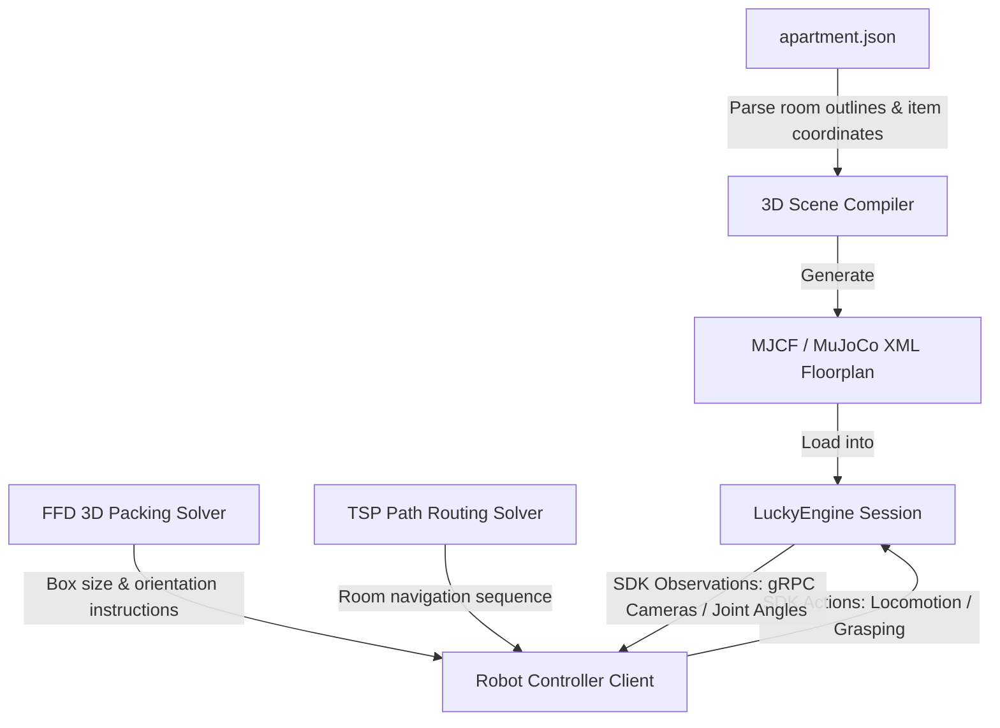

# Research Notes: 3D Simulator Conversion & Lucky Robots SDK Integration

This document outlines the design and technical steps required to convert the **Apartment Moving Simulator** into a 3D simulation environment utilizing the **Lucky Robots SDK**.

---

## What is the Lucky Robots SDK?

The [Lucky Robots SDK](https://github.com/luckyrobots/luckyrobots) is a Python interface for **LuckyEngine**, a high-fidelity simulator combining:
- **Unreal Engine:** For photorealistic camera feeds, rendering, and visual environment assets.
- **MuJoCo:** For high-performance, accurate multi-joint physics contact dynamics.
- **gRPC Protocol:** For low-latency communication between the simulation process and control scripts.

It allows developers to spawn mobile manipulators (e.g., Hello Robot Stretch) or humanoid robots (e.g., Unitree G1) inside custom scenes and control them using Python.

---

## 3D Conversion & Integration Architecture

To transition the moving simulator from 2D visualization into a 3D robotic simulation, we would implement the following architecture:



### 1. Compiling the 3D Apartment Scene (MJCF)
To load our layout into LuckyEngine/MuJoCo:
- **Environment Generation:** We can write a Python script that parses `apartment.json`'s coordinates (relative percentages mapped to physical dimensions, e.g., $100\% = 20 \times 20\text{ meters}$) and automatically compiles a MuJoCo XML (`.xml`/MJCF) file.
- **Walls & Doors:** Represent walls and boundaries as box geometries (`<geom type="box" ...>`) to serve as physical obstacles.
- **Furniture & Items:** Define collision bodies for mattresses, TVs, bookshelves, and tables based on the dimensions in the inventory list.
- **Importing Robot Models:** Custom robot assemblies in URDF format can be converted into MJCF files using the standard MuJoCo `compile` command line tool so they load smoothly.

### 2. Robot Control via Lucky Robots SDK
You can install the SDK locally:
```bash
pip install luckyrobots
```

In Python, the simulator session can be controlled programmatically to automate the moving tasks:

```python
from luckyrobots import Session

# Initialize the 3D moving session
with Session() as session:
    # Spawn the Unitree G1 humanoid inside our custom apartment scene
    session.start(
        scene="my_apartment_layout.xml", 
        robot="unitreeg1", 
        task="moving_day"
    )
    
    # Reset scene items to their start positions
    obs = session.reset()
    
    # Chronological TSP Route Loop:
    # 1. Navigate to target room centroid (e.g. Utility Room)
    # 2. Query observations (RGB-D cameras) to locate the "dryer"
    # 3. Apply joint actions to grasp and carry the item
    # 4. Return to the Entry staging area and place the item
    for step in walkthrough_steps:
        target_coords = step["coordinates"]
        # Low-level actuator control commands (joint angles, target velocities)
        obs = session.step(actions=compute_control_loop(obs, target_coords))
```

### 3. Combining the Solvers
- **Bin Packing Solver:** Calculates the exact 3D coordinates ($x, y, z$) and orientation of items *inside* the boxes. The robot can use these coordinates to position items sequentially into the physical boxes at the Entry staging area.
- **TSP Path Router:** Provides the optimal room visit list (e.g., Utility Room ➔ Kitchen ➔ Bedroom 3 ➔ ...). The robot uses this list as its top-level waypoint itinerary.

---

## Recommendations & Next Steps

1. **Convert Layout Bounds to Physical Metric Coordinates:** Currently, the rooms use percentage-based coordinates $(0-100\%)$. We should define a fixed scale factor (e.g., $1\text{ unit} = 0.5\text{ meters}$) to generate accurate physical dimensions in the MuJoCo/LuckyEngine XML environment.
2. **Procedural MJCF Generator Script:** Write a new utility `compile_3d_scene.py` that takes `apartment.json` and outputs a `.xml` file containing the rooms as rooms/walls and inventory items as interactive rigid bodies.
3. **Simulate Navigation Tasks:** Install the `luckyrobots` library and execute basic trajectory planning to guide the robot along our optimal TSP path.
